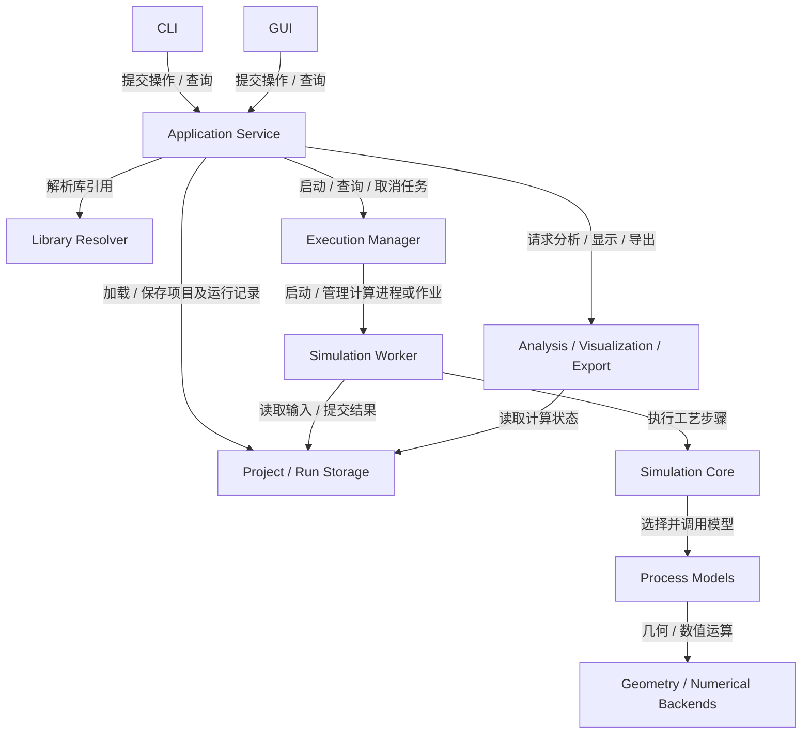
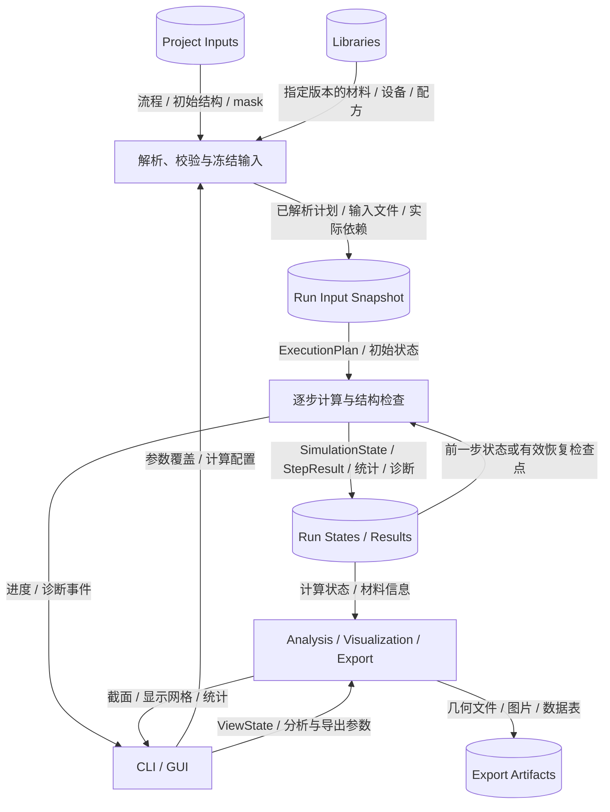

# Nowprocess3D — Software Architecture


## 设计目标

- 用工艺流程逐步构建、模拟、检查和展示 3D 器件结构。
- CLI 提供完整功能，GUI 提供交互操作；工艺执行、项目管理、分析、导出及视图配置均能通过 CLI 完成，部分诊断命令仅提供 CLI。
- 首先支持 Linux 无桌面运行，再扩展 Windows 和 macOS。
- 模块通过明确、带版本的接口协作，使兼容升级尽量局限在模块内部；破坏接口或数据格式的升级需要适配或迁移。
- 首版完成可验证的几何工艺模型，再逐步增加物理模型。每个模型声明假设、适用范围和验证依据。
- 每次实现一个可独立 review 的功能，提供运行命令、预期结果和验证记录。

## 总体分层

### 调用关系

箭头 `A → B` 表示 A 调用 B 的接口或启动/管理 B。箭头标签说明调用目的；返回值、进度回传与文件内容在下一张数据流图中表示。



例如，结果模块调用 Storage 的读取接口，所以调用箭头是 `VIEW → STORE`；Storage 中的状态返回给结果模块时，数据的流向是 `STORE → VIEW`。

### 数据流

箭头表示标注的数据从来源流向接收方。矩形表示数据处理过程，圆柱表示持久化数据；图中将 Worker、Core、Models 和 Backend 合并为一个计算过程。



`Run Input Snapshot` 包含本次实际使用的输入与依赖；`Run States / Results` 保存逐步产生的状态和结果，两者都属于运行目录。每一步读取前一个成功状态，检查通过后提交新状态；恢复运行时使用兼容的检查点。

数据流图表示逻辑上的来源与去向，中间的接口调用由调用关系图说明。例如，进度事件可经 Execution Manager 和 Application Service 传给 CLI / GUI。

Domain Model 定义各模块共用的数据。CLI 和 GUI 调用同一套 Application Service；核心计算不依赖 GUI、命令行解析器或作业调度器。

初期采用同一工程内的模块划分，Worker 可作为独立进程。模块接口先用直接调用实现，网络服务和动态插件系统按实际需要增加。

## 1. Simulation Core

### 1.1 工艺、模型、后端与计算配置

原来的“Fast / Accurate 下各放几个 Core”拆成四个维度：

| 维度 | 职责 | 示例 |
| --- | --- | --- |
| Process Operation | 定义用户要执行的工艺 | Deposition、Etch、CMP |
| Process Model | 定义材料如何变化 | 理想共形生长、指定方向去除、基于速率的表面演化 |
| Backend | 表示结构并完成几何/数值计算 | 实体几何、体素、Level Set 等候选方案 |
| Execution Profile | 配置计算精度与资源 | Fast、Accurate、自定义分辨率与容差 |

Fast / Accurate 是配置预设，可以调整分辨率、容差等设置；若还会更换模型，必须在执行计划中显示。更细的网格不自动代表更准确的物理预测。

每个模型声明支持的后端、参数、边界条件与限制；每个后端声明能力。执行前检查流程兼容性，不支持的操作明确报错，替代模型由用户明确选择。

首版只实现一个后端和少量模型，以简单注册表组织。初期每次运行固定一个后端；跨后端转换后续按需增加，并检查材料、单位、精度及状态变量的损失。

### 1.2 支持的工艺

| 工艺 | 建议模型分类 | 必须定义的输入与行为 |
| --- | --- | --- |
| Deposition | Planar、Directional、Conformal、Selective Conformal | 材料、厚度或时间、可达表面、入射方向、选择性规则 |
| Etch | Directional、Isotropic、后续扩展的 Anisotropic 模型 | 目标材料、深度或时间、速率/选择比、mask、停止条件 |
| CMP | 理想平面截除；后续增加去除速率模型 | 参考平面、目标高度、可去除材料、停止规则 |
| Material / Chemistry Change | 材料转换；后续增加反应模型 | 反应区域、源/目标材料、消耗与生成规则、属性变化 |
| Flip Wafer | 晶圆相对设备的姿态变换 | 翻转轴、中心、当前加工面、后续方向和 mask 坐标 |
| No Geometry Change | 注释、等待、工艺记录、属性更新 | 是否改变属性或工艺历史，是否需要物理求解 |

工艺名称与几何行为分别记录：

- **Planar Deposition**：在指定平面区域增加薄膜的简化操作，需要规定支持的输入表面。
- **Directional Deposition**：按入射方向沉积；遮挡、角分布和侧壁覆盖由模型声明。Sputter / Evaporation 可作为设备与配方类别。
- **Conformal Deposition**：在可达表面沿法向生长的理想几何模型。ALD 具有共形覆盖能力，因此原稿的 `Vertical Deposition: ALD` 调整为这一分类；实际覆盖程度由具体模型描述。[Fraunhofer IOF](https://www.iof.fraunhofer.de/en/competences/coating-and-surface-functionalization/conformal-coating-with-atomic-layer-deposition.html)
- **Selective ALD**：增加可生长材料/表面的选择规则，区分理想完全选择性与后续扩展模型。
- **Dry / Wet Etch**：保留为工艺类别，方向性与选择比独立定义。Dry Etch 也存在各向同性工艺，不能直接等同于垂直刻蚀。[EPFL CMi](https://www.epfl.ch/research/facilities/cmi/equipment/etching/oxford-prs900/)
- **Oxidation**：仅换材时标注为简化材料转换；描述氧化生长时，另行定义基底消耗、产物生成与体积变化模型。
- **No Geometry Change**：仍可能改变材料属性或历史。退火等步骤若要预测属性变化，需要相应模型；只记录步骤时明确标注。

### 1.3 Mask、坐标与边界

- 首先支持基础二维图形 mask，后续增加多边形和 GDS 导入。
- mask 包含坐标系、加工/投影面及开口/保护区域约定；有厚度的光刻胶作为真实材料区域建模。
- 固定晶圆坐标，另外记录设备坐标与晶圆姿态。Flip Wafer 更新姿态，后续工艺方向和 mask 通过坐标变换解释。
- 相机旋转只改变观察方式，不改变加工方向或当前加工面。
- 定义有限计算区域、侧边/底部边界、外部环境和封闭空洞。相关模型必须说明哪些表面与外部连通、能被工艺接触。

### 1.4 Core 接口

```text
validate(step, state_metadata, capabilities) -> diagnostics
apply(state, resolved_step, context) -> StepResult
```

`StepResult` 包含新状态、统计量、诊断和产物引用；`context` 提供单位/精度策略、进度与取消信号。大量几何数据可通过状态句柄或文件引用传递。

每一步在计算及结构检查完成后才提交为成功状态；失败时保留此前成功状态和当前错误。后端原生数据经接口访问，不向 GUI 暴露内部可变对象。

## 2. GUI

### 2.1 3D Viewer

- Bird's-eye、Top / Bottom / Side View，支持透视和正交投影。
- Cross-section View：指定切面位置和法向，查看材料分区与尺寸。
- 材料/区域选择、隐藏、透明度、图例、比例尺和测量。
- 查看已保存步骤，对比不同步骤的结构变化。
- 保存视图配置及导出截图；CLI 提供对应配置与导出能力。

显示网格是计算状态生成的可视化产物；显示精度与计算精度分别配置。仅供显示的网格不能直接作为恢复计算的状态。

### 2.2 Process Flow Manager

- 新增、删除、复制、排序、启用/禁用步骤，编辑名称与备注。
- 展示步骤状态、进度、耗时与诊断。
- 从有效状态继续执行，或从指定步骤重新运行。
- 修改第 N 步后，将该步骤及之后的旧结果标为过期；历史运行仍可查看。
- 撤销/重做作用于流程草稿，已有运行记录保留原始输入。

### 2.3 Process Step Details

展示工艺、设备/配方引用、实际参数、单位、模型、后端、精度配置和输入/输出摘要。GUI 表单与 CLI 使用相同的参数定义及校验规则。

### 2.4 CLI Console 与 Menu Bar

嵌入式 Console 使用与独立 CLI 相同的命令分发规则；菜单提供项目、运行、视图、库与帮助入口。

GUI 通过结构化服务接口读取状态和进度，不解析终端文本。计算与作业等待由独立 Worker/后台任务承担，避免阻塞界面。

## 3. Libraries

### 3.1 Tool / Recipe Library

- `ToolDefinition`：设备或工艺类别、支持的操作、参数与范围。
- `RecipeDefinition`：可复用的工艺参数、模型引用、版本及适用说明。
- 使用温度、压力、功率等设备参数预测结构时，需要相应模型或标定关系；几何模型可直接使用厚度、深度或速率。
- 实际参数由库配方与步骤中的显式覆盖合并，完整保存在运行记录中。

### 3.2 Material Library

| 数据 | 内容 |
| --- | --- |
| Identity | 稳定 ID、名称、版本、来源和备注 |
| Simulation Properties | 所选模型实际使用的属性、单位与适用条件 |
| Appearance | 颜色、透明度、显示粗糙度等外观设置 |

外观与计算属性独立，修改颜色不使计算结果失效。同一材料可以出现在多个独立区域中。

### 3.3 Mask / Flow Template Library

复用 mask 图形与小型工艺流程。导入项目时解析参数和依赖，不携带其他项目的运行状态。

### 3.4 库作用域与共享

- Common Library：随软件提供的公共定义。
- User Library：用户维护的自定义定义。
- Project Library：随项目保存的专用定义。

引用包含明确来源、ID 和版本；同名不等于同一项，覆盖必须显式选择。每次运行冻结实际依赖及参数，公共库更新不改变已有结果。

## 4. Project 与 Domain Model

### 4.1 共用数据对象

| 对象 | 职责 |
| --- | --- |
| Project | 项目标识、格式版本、初始结构、流程、依赖和默认配置 |
| ProcessFlow / ProcessStep | 有序步骤、稳定 ID、参数、启用状态和引用 |
| MaterialDefinition / Region | 材料定义与实际占据的区域 |
| MaskDefinition | 图形、单位、坐标系和极性 |
| SimulationState | 后端原生结构、材料分区、姿态及模型所需状态变量 |
| ExecutionPlan | 已解析参数、模型、后端、版本及精度配置 |
| Run / StepResult | 冻结输入、执行状态、日志、统计与产物 |
| ViewState | 相机、切面、显示过滤与外观覆盖 |

持久化格式带版本；尺寸带单位，内部计算统一转换。规定几何容差、最小可表示特征，以及低于分辨率时的处理规则。

初始结构首先支持简单衬底，后续支持结构导入。定义材料归属、区域重叠、空隙及边界的含义。

### 4.2 项目目录建议

```text
device_project/
├── project.yaml          # 版本、单位、初始结构、依赖及默认配置
├── flow.yaml             # 工艺流程
├── library/              # 项目材料、设备与配方
├── masks/                # mask 定义或导入文件
├── inputs/               # 初始结构及其他输入
├── views/                # 保存的视图配置
└── runs/
    └── <run_id>/
        ├── manifest.json # 冻结输入、依赖、版本及执行配置
        ├── status.json   # 当前运行状态
        ├── events.jsonl  # 结构化进度与诊断
        ├── states/       # 可恢复的计算状态
        └── exports/      # 网格、截面、图片与统计
```

文件格式在实现前确定，这里的 YAML / JSON 用于说明职责。依赖以相对路径组织；共享时打包实际引用的库及输入，运行结果可选择包含。缺失依赖在运行前报告。

输入编辑与运行结果分开，每次运行有独立 ID。运行期间更新状态，完成后保留输入与结果。恢复计算要求状态、模型和后端版本兼容；否则从兼容检查点或初始结构重新运行。

## 5. Application Service 与 Execution Manager

### 5.1 应用接口

| 接口 | 职责 |
| --- | --- |
| Project Service | 创建、加载、保存、校验、打包项目 |
| Library Service | 查询、解析、导入和管理库引用 |
| Planning Service | 检查单位、参数、依赖及能力，生成执行计划 |
| Run Service | 启动、查询、取消、恢复执行 |
| Result Service | 检查状态、提取截面、生成视图及导出 |

接口定义输入输出、错误类型与版本兼容规则；实现升级时用少量跨模块契约用例验证。数据格式升级提供迁移或明确拒绝读取，避免静默误读。

诊断包含步骤 ID、字段、原因与建议。CLI 提供人可读文本、结构化 JSON 及稳定退出码；GUI 使用相同诊断数据。

### 5.2 运行步骤

以下说明执行顺序；数据的来源、保存位置与去向见前面的数据流图。

```text
加载项目
  → 解析并冻结依赖、参数与模型版本
  → 校验配置及能力，生成 ExecutionPlan
  → 创建 Run，执行器启动 Worker
  → 每步执行前检查当前结构是否满足模型条件
  → 计算 → 检查结构 → 提交步骤状态与结果
  → 生成指定分析、显示及导出产物
```

配置与能力校验提前执行，依赖实际几何的检查逐步执行。取消在安全检查点生效，中断步骤不能标记为完成。

仿真与后处理分别记录结果：图片导出失败时仍保留成功的计算状态，后续可以单独重做导出。

### 5.3 本地与集群执行

- Local Executor：在允许本地计算的机器上启动独立 Worker。
- Batch Executor：准备输入、提交作业、记录 job ID、读取状态和结果。
- CRC 使用 `qsub`；登录节点只做轻量编辑、校验和作业管理。重计算、环境创建与编译在计算节点完成。
- 调度参数、资源和路径映射由环境配置提供，不写入工艺模型。
- 作业输入准备到计算节点可访问目录，不依赖登录节点的 FUSE 挂载。
- 终端或 GUI 退出后，已提交作业仍可独立查询，运行目录保留作业信息。

### 5.4 CLI 草案

```bash
process3d project init demo
process3d validate demo
process3d plan demo --profile fast
process3d run demo --profile fast --executor crc
process3d status demo --run <run_id>
process3d inspect demo --run <run_id> --step <step_id>
process3d export demo --run <run_id> --step <step_id> --format <format>
process3d cancel demo --run <run_id>
```

后续补充 `resume`、库管理、截面/视图配置和诊断命令。以上是接口示例，尚不可执行。

## 6. 跨平台与实现顺序

核心模块使用统一路径、序列化和进程接口；调度器、环境准备及 GUI 集成放入平台适配层。Linux 首先完成无显示运行，再验证 Windows / macOS 安装与依赖。

建议按以下 review 单元推进：

1. **Domain Model + CLI 校验**：确定单位、初始结构、材料、步骤和错误格式。
2. **单后端验证**：检查薄层、接触边界、材料归属、体积及保存/恢复，据此选择首个后端。
3. **第一条运行链路**：衬底 → 平面堆叠 → 状态保存 → 检查/导出，通过 CRC 作业运行。
4. **Mask + Directional Etch**：完成一个带尺寸的真实简化工艺，核对截面和材料分区。
5. **项目与库闭环**：冻结引用、共享打包、过期结果识别、失败与取消处理。
6. **GUI 最小版本**：Viewer、流程列表、步骤详情及已有结果查看。
7. **逐项扩展模型**：Conformal Deposition、Flip、CMP、化学变化等独立验收，再按需要增加后端与 Accurate 配置。

每个单元提供代码入口、可运行案例、预期尺寸/状态与验证结果。模块随功能逐步增加。

编码前需要确定：第一个基准器件、最薄特征与模型范围、实现语言、首个几何后端和导出格式。本文件作为当前架构草案；`Proposal.md` 保留为早期 ToDo，后续任务以本架构的确认版本为依据。
